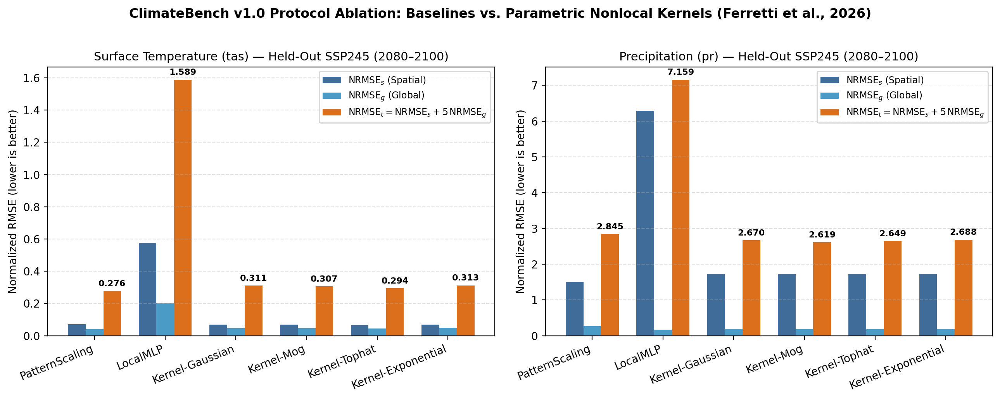
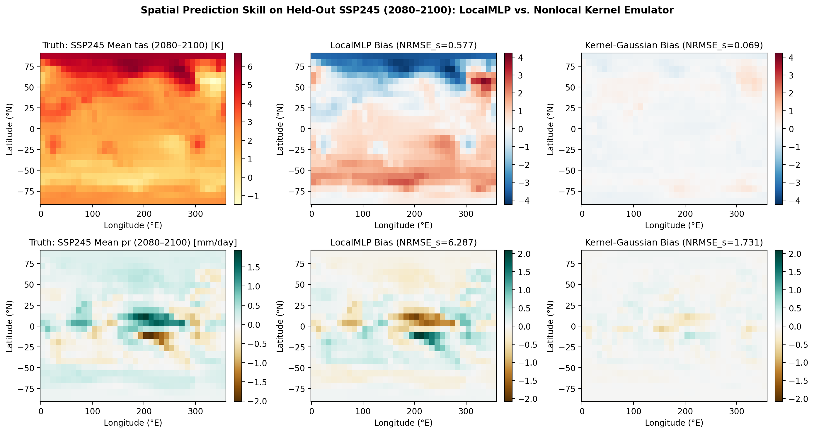
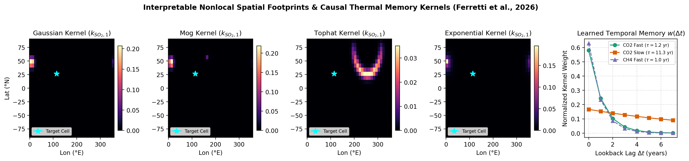
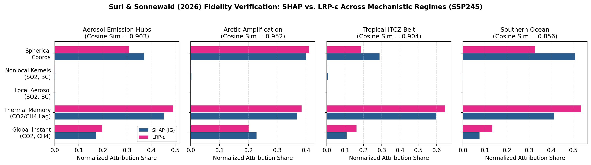
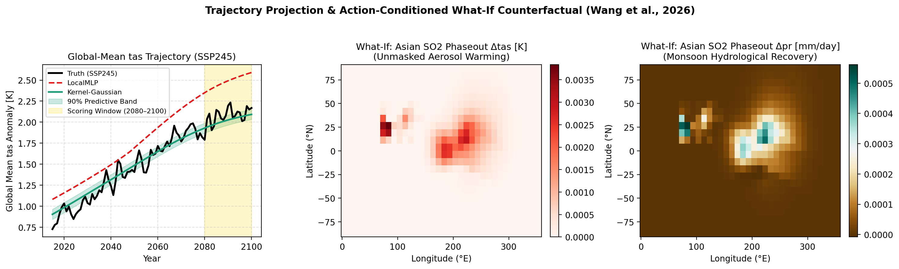

# climate-kernel-emulator

A lightweight, interpretable emulator of the **global forced climate response**: annual-mean surface temperature (`tas`) and precipitation (`pr`), with extremes as an option, under greenhouse-gas and aerosol forcings. It is evaluated on the **ClimateBench** protocol (Watson-Parris et al., 2022, *JAMES*, doi:10.1029/2021MS002954).

Author: M.S. Shyam Sunder ([ORCID 0000-0002-9964-6199](https://orcid.org/0000-0002-9964-6199)). MIT licence.

## Architecture (priority order)
1. **Interpretable nonlocal kernels** (after Ferretti et al., 2026, *EDS*, doi:10.1017/eds.2026.10056): parametric integration kernels (`gaussian`, `mog`, `tophat`, `exponential` + `TemporalExponentialKernel`) aggregate spatial and short temporal context into a small local nonlinear predictor with a closed-form stationary geographic anchor (`src/cke/kernels/`).
2. **Fidelity verification** (after Suri & Sonnewald, 2026, *JGR-MLC*, doi:10.1029/2025JH001211): SHAP + LRP-$\varepsilon$ plus mechanistic-regime checks (`aerosol_hubs`, `arctic_amplification`, `tropical_itcz`, `southern_ocean`), in-distribution and on held-out scenarios (`src/cke/interp/`).
3. **Temporal / probabilistic module**: small Timestral checkpoints (5M / 28M, CPU; Petralia et al., 2026, arXiv:2610.37585) on global-mean and regional series, forcings as known-future covariates (`known_covariates`), quantile forecasts & CRPS (`src/cke/temporal/`).
4. **Optional residual diffusion** (IPSL-AID / CorrDiff inspired; Kingston et al., 2026, arXiv:2604.03275): compact circular-padded denoiser, enabled only if structured residual error remains (`src/cke/residual_diffusion/`).
5. **Action-conditioned what-if** (Earth System World Model inspired; Wang et al., 2026, arXiv:2609.08855): regional and global forcing perturbation interface (`src/cke/whatif/`).

Full plan and status: [`docs/PLAN.md`](docs/PLAN.md).

## Empirical Results on ClimateBench v1.0.0 (`SSP245`, `2080–2100`)

Evaluated on held-out `ssp245` (`2080–2100`) after training on `historical`, `ssp126`, `ssp370`, `ssp585`, `hist-GHG`, and `hist-aer` ($24\times 36$ grid, $< 1{,}900$ trainable parameters; full outputs in [`docs/outcomes.json`](docs/outcomes.json)):

| Model / Family | Params | `tas` $\text{NRMSE}_s \downarrow$ | `tas` $\text{NRMSE}_g \downarrow$ | `tas` $\text{NRMSE}_t \downarrow$ | `pr` $\text{NRMSE}_s \downarrow$ | `pr` $\text{NRMSE}_g \downarrow$ | `pr` $\text{NRMSE}_t \downarrow$ |
| :--- | :---: | :---: | :---: | :---: | :---: | :---: | :---: |
| *ClimateBench CNN-LSTM (Watson-Parris et al., 2022)* | $\sim 4.5\times 10^5$ | 0.107 | 0.044 | 0.327 | 2.129 | 0.209 | 3.174 |
| *ClimateBench GP (Watson-Parris et al., 2022)* | Non-param. | 0.109 | 0.074 | 0.478 | 2.327 | 0.344 | 4.048 |
| *ClimateBench Random Forest (Watson-Parris et al., 2022)* | Ensemble | 0.145 | 0.051 | 0.399 | 2.538 | 0.499 | 5.034 |
| **Baseline 1: `PatternScaling` (Linear in $\text{CO}_2$)** | 1,728 | 0.071 | **0.041** | **0.276** | **1.507** | 0.268 | 2.845 |
| **Baseline 2: `LocalMLP` (Gridcell-local only)** | 642 | 0.577 | 0.202 | 1.589 | 6.287 | **0.174** | 7.159 |
| **`Kernel-Tophat` (Ferretti et al. 2026 + Anchor)** | 1,830 | **0.067** | 0.045 | 0.294 | 1.727 | 0.185 | 2.649 |
| **`Kernel-MoG` (2-Component Mixture of Gaussians)** | 1,878 | 0.069 | 0.048 | 0.307 | 1.726 | 0.178 | **2.619** |
| **`Kernel-Gaussian` (Anisotropic Shifted Gaussian)** | 1,830 | 0.069 | 0.048 | 0.311 | 1.731 | 0.188 | 2.670 |
| **`Kernel-Exponential` (Isotropic Exponential Decay)** | 1,822 | 0.069 | 0.049 | 0.313 | 1.731 | 0.191 | 2.688 |

### Diagnostic Figures
- **Ablation Bar Chart**: 
- **`SSP245` (`2080–2100`) Spatial Predictions & Biases**: 
- **Learned Physical Spatial & Temporal Integration Kernels**: 
- **Suri & Sonnewald (2026) SHAP vs. LRP-$\varepsilon$ Fidelity Audit**: 
- **Multi-Scenario Trajectories & What-If Asian $\text{SO}_2$ Phaseout**: 

## Status
| Step | Content | Status |
|---|---|---|
| 1 | Data, pattern-scaling + local-MLP baselines, Hydra, seeds, tests, CI, aggregate time series | Done |
| 2 | Kernel layer (`SpatialKernelLayer`, `TemporalExponentialKernel`) + `KernelEmulator` (`model=kernel_mlp`) | Done & benchmarked |
| 3 | NRMSE on held-out ssp245 (2080–2100), physical diagnostics, Timestral `known_covariates` + CRPS | Done & benchmarked |
| 4 | Kernel parameter export (`kernels.json`), Suri–Sonnewald SHAP/LRP fidelity checks, optional residual diffusion | Done & verified ($\cos\theta = 0.856\text{--}0.952$) |
| 5 | Reproducibility suite (`scripts/generate_plots_and_outcomes.py`), what-if counterfactual interface (`apply_action`), Antigravity customizations (`AGENTS.md`, `.agents/skills/`) | Done |

## Hardware constraints
Everything must run on a **2 GB GPU with 32 GB RAM**, or on CPU:
- Coarse grid via `data.coarsen` (2 turns the native 96×144 grid into 48×72; 4 turns it into 24×36).
- Small models (the local MLP has hidden width 32; `< 1,900` total trainable parameters).
- Annual means only, ensemble-averaged, so the full training set fits in RAM.

## Setup
```bash
conda create -n cke python=3.11 -y && conda activate cke
# CPU:  pip install torch --index-url https://download.pytorch.org/whl/cpu
# GPU:  pip install torch            (pick the CUDA build for your driver)
pip install -e .[dev]            # add ,interp for SHAP
pytest -q

# Data: ClimateBench v1.0.0, Zenodo record 7064308 (~0.9 GB, md5-checked, skips files already extracted)
python scripts/download_climatebench.py --dry-run
python scripts/download_climatebench.py --out data/climatebench
```
If the archives extract into a subfolder, set `data.root` to the folder that holds `inputs_*.nc` and `outputs_*.nc`.

## Run
```bash
python -m cke.train model=pattern_scaling
python -m cke.train model=local_mlp data.coarsen=2 train.epochs=50
python -m cke.train model=kernel_mlp model.family=gaussian data.coarsen=2 train.epochs=50
python -m cke.evaluate outputs/*/metrics.json
python scripts/generate_plots_and_outcomes.py     # -> full ablation + 5 figures in outputs/benchmark_suite/
python -m cke.timeseries                          # -> data/timeseries/aggregate_series.csv
python -m cke.timeseries timeseries.format=netcdf timeseries.land_mask=path/to/landfrac.nc
```
- Train scenarios: historical, ssp126, ssp370, ssp585, hist-GHG, hist-aer.
- Test scenario: ssp245.
- Scoring window: 2080–2100 (`eval.window`; set `eval.window=null` for all years).
- Metrics (latitude-weighted): NRMSE spatial, NRMSE global, and NRMSE total = spatial + 5 × global.

## Layout
```
AGENTS.md           Workspace rules (2 GB GPU budget, ClimateBench protocol)
.agents/skills/     cke-benchmark skill and literature reference
configs/            Hydra: config.yaml, data/, model/, train/, temporal/, residual/, whatif/
docs/               PLAN.md, outcomes.json, figures/
scripts/            download_climatebench.py, generate_plots_and_outcomes.py
src/cke/            data.py, metrics.py, train.py, evaluate.py, timeseries.py, baselines/,
                    kernels/ (Layer 1), interp/ (Layer 2), temporal/ (Layer 3),
                    residual_diffusion/ (Layer 4), whatif/ (Layer 5), utils/
tests/              24 synthetic-data unit & integration tests
```

## Citation
See `CITATION.cff`. Please also cite ClimateBench (doi:10.5281/zenodo.7064308).
